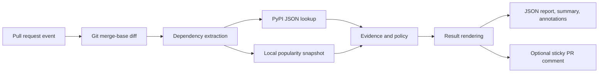

# Architecture

SlopGuard checks Python dependency names added by a pull request. It compares those names with PyPI metadata and a local popularity snapshot, then reports evidence and a policy decision. The scanner treats repository content and registry responses as data; it does not install or execute candidate packages.

## Overview

A pull-request scan uses the base and head commits from the event. It reads the effective policy and allow-list from the base commit, so a proposed configuration change cannot loosen the rules used to evaluate itself. The diff is calculated from the merge base.

## Module map

| Module or path | Responsibility |
| --- | --- |
| [__init__.py](src/slopguard/__init__.py) | Package version and public package metadata. |
| [cli.py](src/slopguard/cli.py) | CLI arguments, event context, scan invocation, report files, workflow outputs, summaries, and annotations. |
| [config.py](src/slopguard/config.py) | TOML parsing, discovery, validation, and immutable configuration. |
| [contracts.py](src/slopguard/contracts.py) | Typed dependency results, scan reports, diagnostics, and policy summaries. |
| [extractor.py](src/slopguard/extractor.py) | Added dependency and absolute Python import extraction; local-module recognition. |
| [git.py](src/slopguard/git.py) | Bounded commit, tree, diff, and blob reads without a shell. |
| [github.py](src/slopguard/github.py) | Optional sticky pull-request comment API client and bounded pagination. |
| [import_names.py](src/slopguard/import_names.py) | Import-to-distribution names from packaged data and reviewed overrides. |
| [pypi.py](src/slopguard/pypi.py) | Canonical package names and public PyPI JSON endpoint construction. |
| [registry.py](src/slopguard/registry.py) | HTTPS transport, request bounds, retries, and PyPI response parsing. |
| [registry_result.py](src/slopguard/registry_result.py) | Registry metadata and sourced evidence merged into a dependency result. |
| [render.py](src/slopguard/render.py) | Bounded Markdown summaries, annotations, and comment content. |
| [scan.py](src/slopguard/scan.py) | Scan orchestration, base-branch policy, lookup scheduling, and result assembly. |
| [scoring.py](src/slopguard/scoring.py) | Explainable score contributions, severity, allow-list handling, and policy decisions. |
| [similarity.py](src/slopguard/similarity.py) | Offline look-alike matching against the packaged popularity snapshot. |
| [schemas/](src/slopguard/schemas/) | JSON Schemas for dependency results and complete scan reports. |
| [data/](src/slopguard/data/) | Popularity data, import-name mappings, and standard-library names shipped with the package. |

## Pull-request scan flow

1. The CLI reads the GitHub event and validates that the event is supported.
2. The Git adapter resolves the base, head, and merge base, then lists changed paths and bounded file contents.
3. The extractor compares supported files and emits newly added or replacement dependencies with source locations.
4. Configuration comes from the base commit. A changed head configuration is reported, but does not decide its own scan.
5. Active allow-list entries pass with their reason and expiry and are not sent to PyPI. Other valid distribution names receive bounded registry lookups.
6. Similarity matching uses the checked-in popularity snapshot and makes no network request.
7. The scorer combines available evidence and applies the configured policy. Unknown registry results stay unverified and cannot block on their own.
8. The CLI writes the JSON report, GitHub job summary, workflow annotations, and the optional sticky comment.

## Dependency extraction

The extractor parses the base and head contents as data and reports additions. Deletions and unchanged declarations are not findings.

| Input | Behavior |
| --- | --- |
| Requirements and constraints files | Reads supported PEP 508 requirement lines, continuations, comments, markers, extras, and hashes. |
| pyproject.toml | Reads PEP 621 dependencies, optional dependencies, PEP 735 dependency groups, and build-system requirements. |
| Python files | Parses absolute import statements with Python's AST and maps known import names to distributions. |
| setup.py, setup.cfg, and Pipfile | Reports that manual review is needed; it does not evaluate or execute these files. |

Relative imports, standard-library imports, known local modules, and imports inside strings are excluded. Unknown namespace roots produce a warning rather than a guessed package name. See [the extractor](src/slopguard/extractor.py) and [the import-name data](src/slopguard/data/import_names.json) for the current mappings.

## Look-alike detection

The matcher normalizes names and compares them with the packaged popularity snapshot. It handles configured edit-distance and separator variants locally. The snapshot records its source URL, source update date, and retrieval date; refresh it with the repository's update script and review the generated diff. Snapshot age and matching limits are described in [SECURITY.md](SECURITY.md).

## PyPI lookup

The registry client requests the public PyPI project JSON endpoint for a normalized package name. It does not fetch package files, wheels, source distributions, or release archives.

| Registry status | Meaning |
| --- | --- |
| `exists` | PyPI returned a valid project record. |
| `not_found` | PyPI returned a validated not-found response for the name. |
| `transient_error` | A timeout, rate limit, connection error, or other temporary failure prevented a result. |
| `malformed_response` | The response could not be parsed as the expected project record. |
| `invalid_name` | The candidate is not a valid distribution name and is not queried. |

Only a confirmed not-found response establishes absence. Errors and malformed responses remain unverified. The client bounds request time, retries, response size, and concurrent lookup count through configuration.

## Scoring and policy

Scoring combines explainable evidence for package absence, name similarity, recent release history, release count, and source links. The active policy sets the warning or blocking behavior and the thresholds. See [examples/slopguard.toml](examples/slopguard.toml) for the defaults and [scoring.py](src/slopguard/scoring.py) for the decision rules.

An active allow-list entry takes precedence and produces `pass` while retaining the score and recording the exception reason and expiry. An expired entry is looked up normally and reported for review. Unknown or malformed registry results never block; the unknown policy may choose `warn` or `pass`, but the result remains marked unverified. Import-only findings are warn-only.

## Output

The scan report is JSON and follows [scan-report.schema.json](src/slopguard/schemas/scan-report.schema.json). The job summary gives the overall decision, effective policy, findings, warnings, and unverified results. Workflow annotations point to changed source locations. When the user enables comments and grants `pull-requests: write`, the GitHub client creates or updates one sticky comment; it skips fork pull requests.

Summary, annotation, and comment output is bounded and escapes report-derived text. The comment client uses the runner's `GITHUB_API_URL`, including on GitHub Enterprise Server. See [render.py](src/slopguard/render.py) and [github.py](src/slopguard/github.py).

## Result contract and versioning

The scan report records the effective base-branch policy in `policy`. Dependency results can include `allowlisted` and an `allowlist` object with the exception reason and expiry.

The dependency result contract is version `1.1.0`, defined by [dependency-result.schema.json](src/slopguard/schemas/dependency-result.schema.json). The scan report has its own schema and embeds dependency results. Typed shapes live in [contracts.py](src/slopguard/contracts.py), with valid examples in [tests/fixtures/contract/](tests/fixtures/contract/).

Optional fields can be added when existing consumers can ignore them. Changing a field's type or meaning, removing a field, or changing decision semantics requires a contract version update and coordinated fixture and consumer changes. Keep the schemas, Python types, fixtures, and this section aligned in the same change.

## Security model and trust boundaries

Pull-request paths, manifests, source text, configuration, event payloads, and PyPI responses are untrusted. SlopGuard parses supported inputs but never imports or executes the checkout, dependency candidates, archives, setup scripts, or build hooks. Git reads use bounded operations and argument arrays.

The policy and allow-list come from the target base commit. Workflows use `pull_request`, declare least-privilege permissions, pin third-party actions, and disable checkout credential persistence. The scanner sends normalized package names to PyPI but does not upload source files, filenames, or pull-request text. Optional comments send rendered findings to the GitHub API and require an explicit write permission. Timeouts, malformed data, rate limits, and exhausted lookup budgets remain unverified.

Repository-level Actions settings are a separate boundary. Keep fork workflows from receiving write tokens or secrets. The [security policy](SECURITY.md) explains reporting, data use, controls, and limitations; the [security review](SECURITY_REVIEW.md) records the assessment and verified settings.

## Evaluation subsystem

The evaluation tools in [evals/](evals/README.md) build and verify labels, record registry responses through explicit manual commands, and replay scans offline. They are not imported into the runtime package or included in its wheel. CI reproduces the committed evaluation outputs and runs the offline classifier checks.

## Extending SlopGuard

- Add a dependency format in the extractor and cover additions, replacements, deletions, and unsupported syntax with fixtures.
- Add or change a scoring signal in the scoring and configuration layers, then update the contract-facing documentation and evaluation method.
- Use the injectable registry transport for any registry behavior. Keep request limits and failure states explicit; do not add package installation or execution.
- Update import-name mappings through their data-generation and review workflow. Do not hand-edit generated mappings.
